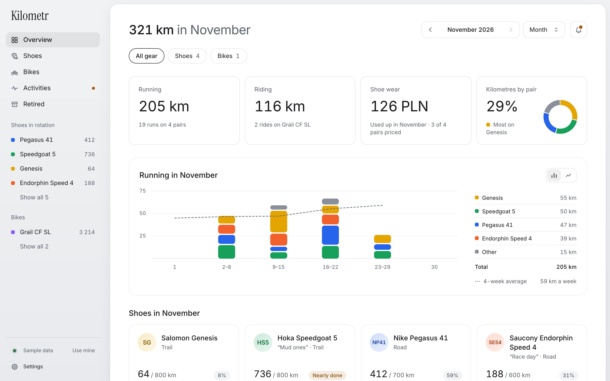
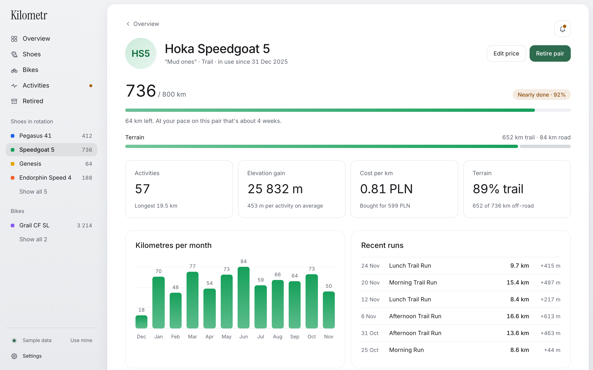
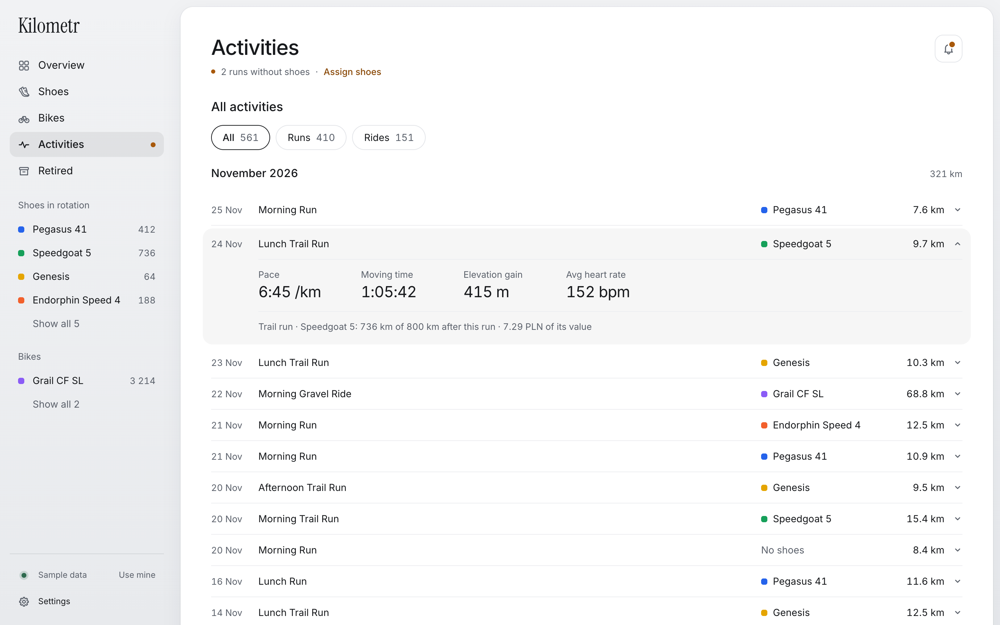
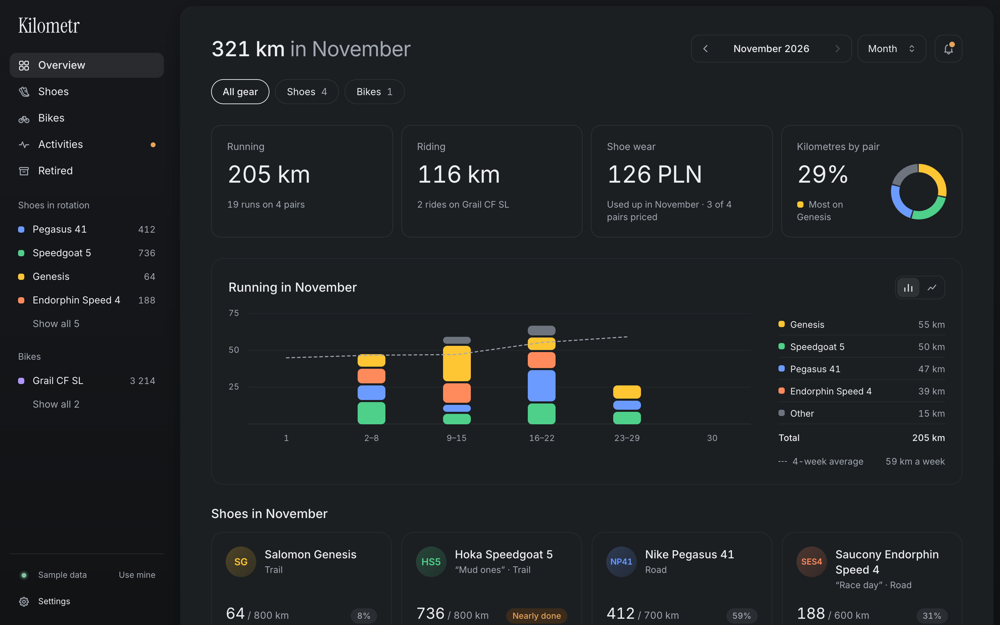
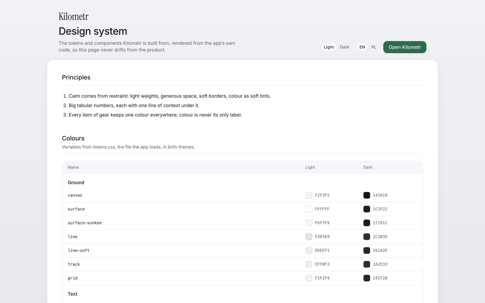
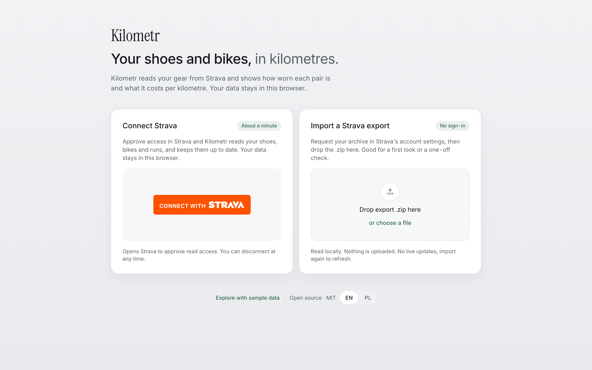
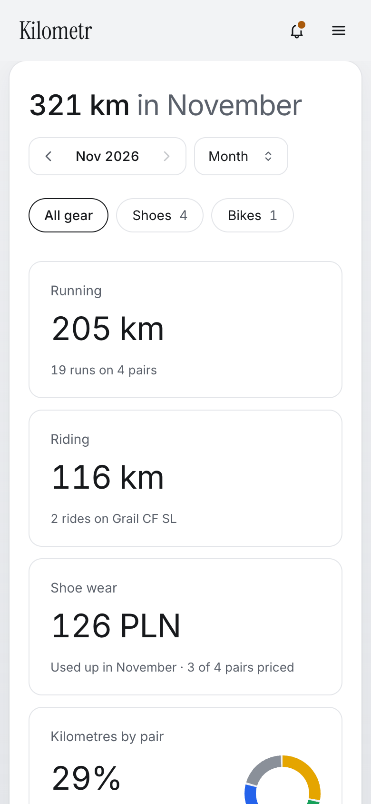
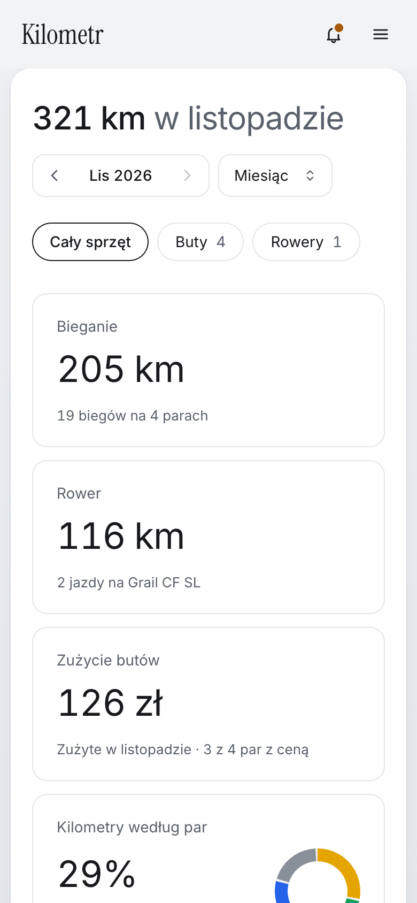

# Kilometr

A local-first tracker for the kilometres on your running shoes and bikes, fed by Strava.

Kilometr does one thing: it shows **how worn each item of gear is and what it has cost per kilometre**. It is not a training analytics tool. Your data stays in your browser: no accounts and no database.

**Live:** [kilometr-roan.vercel.app](https://kilometr-roan.vercel.app) · **Design system:** [/design-system](https://kilometr-roan.vercel.app/design-system)



<table>
  <tr>
    <td width="50%"></td>
    <td width="50%"></td>
  </tr>
  <tr>
    <td></td>
    <td></td>
  </tr>
  <tr>
    <td></td>
    <td>
      
      
    </td>
  </tr>
</table>

<sub>Screenshots use the built-in sample data.</sub>

## What it does

- **Two ways in.** Connect Strava (OAuth, live sync) or import a Strava export (.zip), read entirely in the browser.
- **Wear per item.** Each pair's km against its limit, km left and a rough "weeks left" at your pace. From 85% it's "Nearly done", past 100% "Over limit".
- **What running costs.** Enter a price and Kilometr shows the cost per km, and how much shoe value a month used up.
- **The selected period.** Overview covers a month or a year: running and riding km, km by pair, a weekly chart (bars or lines) with a 4-week average, and the gear used in it.
- **Activities.** Every run and ride by month; a row opens in place with pace, moving time, elevation, heart rate and the gear's km after it. Runs without shoes get a suggested pair.
- **Rotation and colour.** Gear used in the last 60 days is in rotation and gets one of 7 hues that follows it everywhere; everything else is granite.
- **Calm by design.** Light and dark themes, English and Polish, works on a phone, keyboard and screen-reader friendly.

## Design system

Kilometr's tokens and components are documented by the app itself at [/design-system](https://kilometr-roan.vercel.app/design-system): colour variables in both themes, the type scale, spacing, radii and shadows, then the real components rendered on sample data, so the page can't drift from the product. The tokens live in [`src/styles/tokens.css`](src/styles/tokens.css).

## Run it

You need Node.js 20 or newer.

```bash
npm install
npm run dev
```

Open http://localhost:5173 and choose **Explore with sample data**. To connect Strava locally, copy `.env.example` to `.env.local` and fill in your Strava API app's Client ID and secret.

| Script | What it does |
| --- | --- |
| `npm run dev` | Dev server |
| `npm run build` | Type-check and production build |
| `npm test` | Unit tests for the domain logic, import and Strava mapping |

## How it works

- **Local-first.** Everything is kept in IndexedDB in your browser. The only server code is the Strava token exchange ([`server/stravaToken.ts`](server/stravaToken.ts)), because the Client Secret must not reach the browser; it stores nothing.
- **Light on Strava's limits.** The first sync reads a year of activities and takes older km from Strava's own total per item; later syncs read only what's new. A full history refresh is there in Settings when you want it.
- **Rotation** means gear used in the last 60 days. On a past month's charts, gear out of rotation borrows a free hue so it's named, not hidden under "Other".
- **Wear** is the item's km divided by its limit; **cost per km** is the price divided by the km.

## Structure

```
src/
  app/          store, routing, layout
  components/   UI building blocks (Avatar, WearBar, GearCard, WeeklyChart, ShareDonut, …)
  screens/      Start, Overview, Shoes, Bikes, gear detail, Activities, Retired, Design system
  domain/       types and pure calculations (gear stats, period numbers, activity details)
  strava/       OAuth, sync and mapping from the Strava API
  import/       Strava export: zip reader, CSV parser, mapping to gear and activities
  i18n/         English and Polish copy, number and date formats
  data/         sample dataset
  lib/          dates, colours, storage
  styles/       design tokens and base styles
server/         Strava token exchange (Vite middleware in dev, Vercel function in production)
docs/           screenshots
design/         reference mockups and tokens
```

## Built with

React 19, TypeScript, Vite and CSS modules; Vitest for tests; hosted on Vercel. Designed and built by [Konrad Wysokiński](https://github.com/konradwysokinski) with Claude Code, as a portfolio piece on designing and shipping a product end to end.

## Licence

[MIT](LICENSE)
